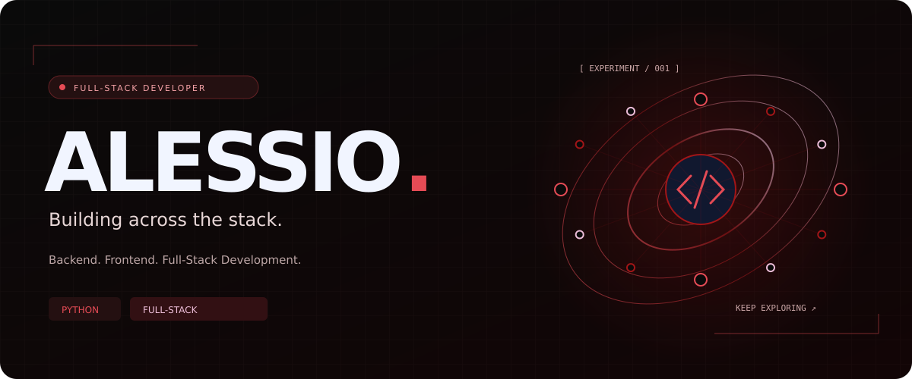

  

  
  &nbsp;
  

## Hey, I'm Alessio 👋

I'm a **Full-Stack Developer**. I build across the stack, from backend services and APIs to user-facing applications.

 

## 🧰 Tech stack

  

Always building and learning.

